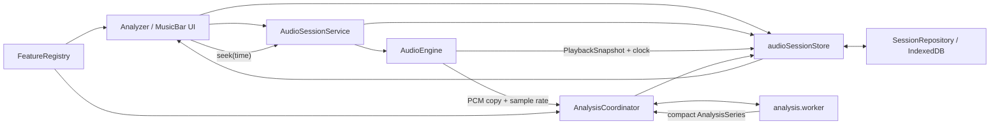

# System Design

## 1. Decision Summary

AudioNotSurfYet 采用一个实时 `AudioEngine`、一个 MainLayout-owned `AudioSessionService`、一个可序列化 `audioSessionStore`、一个 `AnalysisCoordinator` 和一个全曲分析 Worker。Analyzer 通过类型化特征注册表选择最多四个不重复特征，在共享时间视窗中用 Canvas 2D renderer 绘制数据，并用 DOM 承担文本、交互和无障碍语义。

当前设计只覆盖已批准的本地音频学习场景。远端上传、Editor、Visualizer、移动端和非 Chromium 兼容均不进入本架构。

## 2. Goals and Non-Goals

### Goals

- 保持一个实时 AudioContext 和一致的播放时钟。
- 让全曲 Meyda 计算、聚合和紧凑编码离开主线程。
- 让最多四张分析卡共享视窗、缩放、游标和点击跳转。
- 用稳定的类型契约支持 `src/data/analyzerData.ts` 全部 21 个特征。
- 在刷新后恢复最近一次队列、当前歌曲、分析卡和可用缓存，同时正确处理文件权限。
- 让黄金正确性、100ms 游标偏差、主线程响应和资源清理可以自动验证。

### Non-Goals

- 不提供麦克风、远端音频、编辑、导出、账户或长期曲库。
- 不并行建设多个播放引擎，也不为旧状态模型增加长期兼容层。
- 不一次性计算或持久化全部 21 项特征。
- 不在 Analyzer 中新增 Three.js。
- 不在本阶段决定发布平台、监控和回滚。

## 3. Constraints and Inputs

- 音频：本地 MP3/WAV/FLAC，目标最长约 15 分钟。
- 浏览器：最新稳定版 Chrome/Edge 桌面端，HTTPS 或 localhost。
- 分析：frame 1024、hop 512、Hanning、MFCC 13、分析 PCM 的源采样率；首版只展示参数，不允许修改。
- 活动特征：0–4 个，feature ID 唯一。
- 展示帧率：Worker 输出最多 30Hz 的显示序列；精确游标值按需提取。
- 持久化：只保留最近一次会话、全部队列句柄、当前 Blob 和当前分析缓存。

## 4. Target Components

| Component | Responsibility | Owns | Must not own |
| --- | --- | --- | --- |
| `AudioEngine` | 加载/解码当前音频，播放、暂停、seek、音量、快照和 generation 保护的 PCM 分块复制 | 唯一实时 AudioContext、当前 AudioBuffer、BufferSource、AnalyserNode、GainNode | File/Blob、对象 URL、UI 卡片、队列持久化、分析缓存 |
| `AudioSessionService` | 把 UI 命令编排为文件读取、engine 命令、队列变化、ended 循环和能量快照 | runtime File、封面对象 URL、command generation、单播放 RAF | 可持久化事实、第二个 AudioContext、分析 Worker |
| `audioSessionStore` | 队列、当前 track ID、播放快照、活动卡、视窗和恢复状态 | 可序列化 UI/session 状态 | AudioBuffer、AudioNode、Worker、File/Blob 实例 |
| `SessionRepository` | IndexedDB schema、事务、句柄、当前 Blob/缓存的保存与恢复 | `PersistedSessionV1`、FileSystemFileHandle、当前 Blob、当前缓存 | 播放和 UI 决策 |
| `AnalysisCoordinator` | 构造 mono PCM、启动/取消 job、隔离迟到结果、缓存匹配、精确值请求 | 活动 job generation、Worker 生命周期、内存结果索引 | 实时播放时钟、DOM |
| `analysis.worker` | Meyda frame 提取、聚合、量化、进度和协作式取消 | 当前 Worker job 的 PCM 和临时帧 | IndexedDB、AudioContext、UI |
| `FeatureRegistry` | 21 个特征的 key、形状、renderer、范围、标签和依赖 | 编译期穷尽映射 | 运行时图表实例 |
| Analyzer UI | 选卡、换卡、共享时间轴、说明、精确值和可访问交互 | `ActiveAnalysisCard[]`、`TimelineViewport` 的用户意图 | 音频计算、数据库访问 |
| Canvas renderer family | 把已归一化/解码的 series 绘到给定 viewport | Canvas 2D 绘制状态 | 焦点、按钮、说明文本 |

`AudioEngine` 独占唯一实时 `AudioContext` 与 `AudioBuffer`。M6 不创建 OfflineAudioContext；coordinator 只通过 descriptor + revision 接口按 16,384 samples 分块复制各声道并平均，每块后让出主线程。若未来格式 fixture 证明必须使用指定源采样率的离线解码，需先复核本设计与缓存身份，不能把它当作隐式 fallback。

## 5. Runtime Topology

状态流是单向的：AudioEngine 发布事实快照，AudioSessionService 编排 runtime 资源并更新 store，store 保存序列化状态，UI 只发出命令。store 不包装或代理 AudioNode。

## 6. Playback and Timeline

### Engine lifecycle

1. 选择或恢复当前 track 后，`AudioEngine.load()` 解码并保存当前 AudioBuffer。
2. `play()` 每次创建新的 BufferSource，并记录 `startedAtContextTime` 与 `startedAtOffset`.
3. 播放位置为 `startedAtOffset + (audioContext.currentTime - startedAtContextTime)`；暂停时保存 offset。
4. `seek(seconds)` 截断到 `[0, duration]`；播放中安全停止旧 source 并从新 offset 重建。
5. 换歌、清空或销毁时停止 source、断开节点并使旧订阅失效；封面对象 URL 由 AudioSessionService 在删除、清空和 dispose 时释放。

### Shared timeline

- `TimelineViewport` 是四张卡的唯一时间视窗来源。
- 动画循环只读取 AudioEngine 的基准时间并更新共享游标，不自行累计 delta。
- 播放、暂停、跳转和 track 切换都通过 `PlaybackSnapshot` 收敛。
- 图表点击先把 Canvas x 坐标映射到 viewport 时间，再调用 `AudioEngine.seek(time)`。
- 缩放以指针/键盘锚点为中心，并裁剪到 `[0, duration]`；所有 renderer 接收同一 viewport。

## 7. Analysis Pipeline

### Job construction

1. 当前音频解码完成后，读取 `DecodedAudioDescriptor`，并以 descriptor revision 分块复制各声道。
2. 多声道按每个 sample 的算术平均值混合为 mono；每块后让出主线程，任一 revision 变化立即返回 stale，结果不修改或暴露 AudioEngine 的 AudioBuffer。
3. 计算内容 `trackHash`，并以固定参数生成 `configHash`。
4. `AnalysisCoordinator` 创建递增 generation 的 job，把 mono `ArrayBuffer` 转移给 Worker。
5. Worker 只提取当前活动且不重复的 feature ID。

### Frame extraction and compact output

- frame count 固定为 `max(1, 1 + ceil((length - 1024) / 512))`；frame 起点为 `index * 512 / sampleRate`，末尾不足 1024 时零填充。
- Worker 每处理最多 32 frames 或连续运行 8ms 后报告进度、让出事件循环并检查 cancel 标记。
- 标量特征聚合为最多 30Hz 的时间序列。
- 频率/类别向量先按显示时间桶聚合，再使用带 scale/offset 的紧凑 typed array；不得把 15 分钟的逐 hop 原始频谱保存在 UI 或 IndexedDB。
- 游标精确值由 Worker 针对游标所在原始 frame 按需重新提取，并返回未量化结果。
- 每个 `AnalysisSeries` 都带 `trackHash`、`configHash` 和 `featureId`；缺一不得写入缓存或展示。

### Cancellation and stale-result isolation

- 换歌、活动特征变化、分析参数变化或 coordinator 销毁时，发送 cancel 并递增 generation。
- Worker 取消是资源优化，不作为正确性边界；主线程只接受与当前 `jobId + generation + trackHash + configHash` 全部匹配的消息。
- 迟到的 progress/result/error 被静默丢弃并记录可诊断计数，不能覆盖新 track 的 UI。

## 8. Feature Registry and Renderers

注册表把 21 项 Meyda key 绑定到输出形状和 renderer：

| Family | Features | Renderer |
| --- | --- | --- |
| Scalar time series | RMS、ZCR、Energy、Spectral Centroid/Flatness/Flux/Slope/Rolloff/Spread/Skewness/Kurtosis/Crest、Perceptual Spread、Perceptual Sharpness | 折线/面积时间序列与游标值 |
| Frequency vector | Amplitude Spectrum、Power Spectrum、MFCC | 时频热图与游标向量；MFCC 使用系数轴 |
| Category vector | Chroma | 12 类热图与游标柱图 |
| Waveform | Buffer | 波形包络与游标 frame |
| Loudness structure | Loudness | total 时间线、24 Bark band 热图与游标结构 |
| Complex spectrum | Complex Spectrum | 幅度/相位派生视图与游标实部/虚部详情 |

Meyda 5.6.3 的固定维度是：Amplitude/Power Spectrum 512、Chroma 12、MFCC 13、Buffer 1024、Loudness 24 specific bands + total、Complex Spectrum 的 real/imag 各 1024。注册表另记录 `deliveryMilestone` 与 `workerSupported`；M6 只支持 RMS、Energy、Amplitude Spectrum、Chroma，21/21 登记不表示 21 项产品能力完成。

`spectralFlux` 在锁定版本上已复现依赖内部未声明变量 `x` 的 `ReferenceError`。M6 不 fork、monkey-patch 或启用该特征；它在 M8 前保持阻断风险。

特征依赖（如 amplitude/power spectrum、loudness）在 Worker 内复用同一 frame 的中间值。注册表必须使用 feature ID 的穷尽联合类型；`analyzerData.ts` 新增或移除 key 时，类型检查或覆盖测试必须失败。

首个切片：

- RMS：时间序列折线和精确标量。
- Amplitude Spectrum：时频热图和游标频谱。
- Chroma：12 类热图和游标柱图。

Canvas 只画数据、网格、游标和选择态；标题、解释、参数、数值、按钮、状态与可访问替代信息由 DOM 提供。

## 9. Persistence and Recovery

### Storage model

IndexedDB 使用版本化 schema，分别保存：

- 单个 `PersistedSessionV1`：队列顺序、当前 track、卡片、参数和 UI 快照。
- 队列中每个 track 的 `FileSystemFileHandle`（可用时）。
- 仅当前 track 的 Blob。
- 仅当前 track、当前配置和活动特征的分析缓存。

每项 cache payload 使用 4-byte little-endian header length、UTF-8 JSON header 和连续 typed-array bytes。decoder 必须核对 schema、track/config/feature 身份、payload kind、dimensions、scale/offset 与 byte ranges；错位、缺失、尾随或损坏项只作为 miss 重算。

切换当前歌曲的持久化操作必须在同一逻辑事务中删除旧 current Blob/cache 并写入新记录；失败时保留内存会话并暴露 `not-persisted` 状态。

分析结果使用独立 `replaceCurrentAnalysisCache()` 事务：写入前核对 persisted current track/hash，在同一事务更新 session manifest 与固定 current cache，保持 current Blob 不变。身份变化返回 `stale`；quota/abort 保留旧记录，内存 series 继续可用。

### File selection

- 在支持的安全上下文用 `showOpenFilePicker({ multiple: true, types })` 获取文件和句柄。
- 用户取消不作为错误；不默默回退到无法得到句柄的隐藏兼容路径。
- format/decode 不支持时保留可解释错误，不把无效 track 作为可播放项。

### Refresh recovery

1. 读取 session、当前 Blob、当前缓存和句柄。
2. 恢复队列、当前歌曲、活动卡和 viewport 配置。
3. 当前歌曲优先从已保存 Blob 加载；播放位置强制为 0 且 paused。
4. 缓存身份完全匹配时使用；缺失、损坏或不匹配时重新分析。
5. 对其他 track 按“下一首、上一首、下二首、上二首……”顺序执行 `queryPermission({mode: "read"})`。
6. `granted` 自动调用 `getFile()`；`prompt`/`denied` 标记为 `permission-required`，只有用户点击“恢复访问”时调用 `requestPermission()`。
7. 文件不存在、移动或内容 hash 改变时标记对应恢复状态；不得错误复用旧缓存。

权限不保证跨会话持续。实现必须遵循 [Chrome File System Access 文档](https://developer.chrome.com/docs/capabilities/web-apis/file-system-access) 和 [持久权限说明](https://developer.chrome.com/blog/persistent-permissions-for-the-file-system-access-api) 所描述的用户手势约束。

## 10. Failure Boundaries

| Failure | Boundary and behavior | Verification |
| --- | --- | --- |
| 音频 decode 失败 | 当前 track 标记错误；队列和其他 track 仍可用 | 格式 fixture 与损坏文件 |
| Worker error/crash | 当前 analysis 标记失败，可重试；播放不停止 | Worker error 注入 |
| stale result | coordinator 丢弃，不改变当前 series | 快速换歌/换卡 |
| quota/cache 保存失败 | 当前页面继续；显示无法跨刷新保留，刷新后重算 | IndexedDB quota 注入 |
| permission prompt/denied | 不自动弹出权限；标记并等待用户手势 | 浏览器权限矩阵 |
| 句柄失效/文件移动 | 对应 track 不可恢复，当前 Blob track 仍可用 | mock handle 与手工验证 |
| hash/config 不匹配 | 缓存失效并重算 | cache identity 单元测试 |
| AudioContext suspended | 首次用户手势恢复；UI 反映 paused/suspended | 引擎集成测试 |
| renderer 异常 | 单卡错误边界；其他卡和播放继续 | renderer failure 注入 |

## 11. Security and Privacy

- 不把 File、Blob、PCM、元数据或分析结果发送到网络。
- 文件路径不进入 UI、日志或 telemetry；只显示用户可见文件名和解析元数据。
- IndexedDB 数据只服务最近一次本地会话，并提供清除会话入口。
- FileSystemFileHandle 的保存不代表永久授权；任何权限请求必须由明确用户操作触发。
- 内容 hash 用于本地身份与缓存，不作为用户身份，也不上传。

## 12. Performance and Capacity

- Worker 承担 Meyda、聚合、量化和 hash 的重计算路径。
- 主线程只接收紧凑 series、进度和精确游标值。
- 同一 frame 的频谱依赖在 Worker 内共享，避免对四个特征重复 FFT。
- Canvas 按 device pixel ratio 设置 backing store，重绘只发生在 viewport、数据、尺寸或游标变化时。
- 游标层可与静态数据层分离，避免每帧重画整张热图。
- 大输入期间用户反馈必须在 100ms 内，且无分析归因的主线程任务超过 50ms。
- 不设置全曲分析完成时间 SLA；UI 必须提供进度、取消和明确的 pending/ready/error 状态。

## 13. Observability

开发和测试环境记录结构化但不含文件内容的事件：

- engine load/play/pause/seek/dispose 与快照；
- analysis job start/progress/cancel/complete/error、generation 和耗时；
- stale message 丢弃计数；
- cache hit/miss/identity mismatch；
- restore granted/prompt/denied/missing/quota；
- Canvas 尺寸、活动 renderer 和长任务观测。

M6 只在 `import.meta.env.DEV` 安装无 UI bridge，提供活动特征、cancel、retry、可序列化状态和精确游标读取；它不暴露 File、PCM 或 AudioBuffer，生产构建中不存在。

生产日志策略属于 release 阶段；当前不得为可观测性引入上传。

## 14. Rollout and Compatibility

- 按 delivery 纵向切片接入，先保持 MusicBar 播放行为，再启用持久化/Worker，最后交付分析卡。
- 新状态模型直接替代当前分散职责；不保留两套长期 AudioEngine 或隐藏 legacy fallback。
- 数据库使用 schema version；开发期间允许显式迁移或清除，但 release 前必须固定升级/失败行为。
- 自动化以本机 Chrome 为主；真实 Edge 验证缺失时保留为阻断最终双浏览器声明的证据缺口。

## 15. Alternatives Considered

| Alternative | Decision | Reason |
| --- | --- | --- |
| 保留 MusicBar 内部播放/分析并让 Analyzer 另建上下文 | Reject | 两套时钟和资源所有权会造成漂移、重复解码和难以清理 |
| 在主线程逐帧计算全部特征 | Reject | 不能满足响应与长任务 guardrail |
| 一次预计算全部 21 项 | Reject | 内存、耗时和缓存体积与当前四卡需求不成比例 |
| 只保存文件句柄 | Reject | 权限跨会话不可靠，当前歌曲无法保证无提示恢复 |
| 保存队列全部 Blob 和缓存 | Reject | 15 分钟多文件会放大 quota 与清理风险 |
| 所有图表使用 DOM/SVG | Reject | 高频热图和多卡重绘成本高 |
| Analyzer 使用 Three.js | Reject | 对 2D 数据图没有必要，会增加 bundle、无障碍和资源生命周期负担 |

## 16. Approval Record

`project-owner` 于 2026-07-24 明确要求实现包含本架构决策的计划，因此本系统设计记为 `approved`。该批准使 delivery planning 门禁成立；任何产品意图实质变化或本文核心边界变化都会使下游 delivery、quality 和 release 文档待复核。
