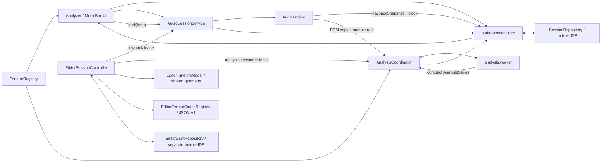

# System Design

## 1. Decision Summary

AudioNotSurfYet 采用一个实时 `AudioEngine`、一个 MainLayout-owned `AudioSessionService`、一个可序列化 `audioSessionStore`、一个 `AnalysisCoordinator` 和一个全曲分析 Worker。Analyzer 通过类型化特征注册表稳定展示 21 张折叠卡，并用最多四项 FIFO 活动队列驱动共享时间视窗中的 Canvas 2D renderer；DOM 承担文本、交互和无障碍语义。M7–M12 的四 slot 模型保留为历史基线，M13 由 ADR-0012 固定全卡/FIFO，M14 由 ADR-0013 增加独立的全局 feature 顺序。

已批准的 Editor 扩展把 E0 产品意图接入同一运行时：Editor 使用 route-scoped playback/analysis lease、版本化本地 JSON、独立单草稿 IndexedDB、tempo 派生网格、点/范围事件和单特征半透明叠加层。它不创建第二个 AudioContext、播放时钟、Worker 或网络数据路径。

已批准的 Visualizer V0 架构在该历史基线上增加第三个 route consumer：使用 `pause-at-end` 播放 lease、0–4 项去重分析 lease、版本化单草稿工程、两个确定性场景和单一 WebGL renderer，并从既有 AudioEngine 的 pre-Gain 音频分支实时录制 WebM。该批准只开放 delivery planning，不得被表述为当前 `/comingsoon` 已实现。

## 2. Goals and Non-Goals

### Goals

- 保持一个实时 AudioContext 和一致的播放时钟。
- 让全曲 Meyda 计算、聚合和紧凑编码离开主线程。
- 让全部 21 张稳定卡可浏览，并让当前最多四张展开卡共享视窗、缩放、游标和点击跳转。
- 用稳定的类型契约支持 `src/data/analyzerData.ts` 全部 21 个特征。
- 在刷新后恢复最近一次队列、当前歌曲、FIFO 活动特征和可用缓存，同时正确处理文件权限。
- 让黄金正确性、100ms 游标偏差、主线程响应和资源清理可以自动验证。
- 让 Editor 在同一播放和分析事实源上完成单曲循环、tempo、点/范围标注、工程 round-trip 与草稿保护。
- 让波形、tempo 网格、事件和分析叠加层共享一个时间几何，目标误差不超过 1 CSS px。
- 让 Visualizer 以同一 AudioContext 时钟把最多四项分析特征和同歌 Editor 快照解析成可重复 seek 的单场景画面，并保存严格本地工程。
- 让支持能力满足预设时，以同一画布和原歌曲音量实时录制 720p/1080p、30/60fps WebM，而不复制播放引擎。

### Non-Goals

- 不提供麦克风、远端音频、PCM 编辑、音频导出、账户或长期曲库；Editor 只导入导出数据工程。
- 不并行建设多个播放引擎，也不为旧状态模型增加长期兼容层。
- 不一次性计算或持久化全部 21 项特征。
- 不在 Analyzer 中新增 Three.js。
- 不实现按歌曲顺序、多选、两卡交换、实时位移动画、第三方拖动依赖或移动端产品支持。
- 不在本阶段决定发布平台、监控和回滚。
- 不在 E0 架构阶段实现 Editor、安装 BPM/文件格式依赖或创建 delivery/quality 证据。
- 不允许 Visualizer 导入可执行模板、叠加多个场景、使用第五个唯一分析特征、创建第二个 AudioEngine/Worker，或静默降低录制分辨率与帧率。

## 3. Constraints and Inputs

- 音频：本地 MP3/WAV/FLAC，目标最长约 15 分钟。
- 浏览器：最新稳定版 Chrome/Edge 桌面端，HTTPS 或 localhost。
- 分析：frame 1024、hop 512、Hanning、MFCC 13、分析 PCM 的源采样率；首版只展示参数，不允许修改。
- 活动特征：0–4 个，feature ID 唯一。
- 展示帧率：Worker 输出最多 30Hz 的显示序列；精确游标值按需提取。
- 持久化：只保留最近一次会话、全部队列句柄、当前 Blob 和当前分析缓存。
- Visualizer：当前本地歌曲、单场景、固定 16:9、一个最新草稿；分析绑定去重后 0–4 项，Editor 直连数据在进入或显式重新载入时形成快照。

## 4. Target Components

| Component | Responsibility | Owns | Must not own |
| --- | --- | --- | --- |
| `AudioEngine` | 加载/解码当前音频，播放、暂停、seek、音量、快照和 generation 保护的 PCM 分块复制 | 唯一实时 AudioContext、当前 AudioBuffer、BufferSource、AnalyserNode、GainNode | File/Blob、对象 URL、UI 卡片、队列持久化、分析缓存 |
| `AudioSessionService` | 把 UI 命令编排为文件读取、engine 命令、队列变化、ended 循环和能量快照 | runtime File、封面对象 URL、command generation、单播放 RAF | 可持久化事实、第二个 AudioContext、分析 Worker |
| `audioSessionStore` | 队列、当前 track ID、播放快照、活动特征 FIFO、视窗和恢复状态 | 可序列化 UI/session 状态 | AudioBuffer、AudioNode、Worker、File/Blob 实例 |
| `SessionRepository` | IndexedDB schema、事务、句柄、当前 Blob/缓存的保存与恢复 | `PersistedSessionV1`、FileSystemFileHandle、当前 Blob、当前缓存 | 播放和 UI 决策 |
| `AnalysisCoordinator` | 构造 mono PCM、启动/取消 job、隔离迟到结果、缓存匹配、精确值请求 | 活动 job generation、Worker 生命周期、内存结果索引 | 实时播放时钟、DOM |
| `analysis.worker` | Meyda frame 提取、聚合、量化、进度和协作式取消 | 当前 Worker job 的 PCM 和临时帧 | IndexedDB、AudioContext、UI |
| `FeatureRegistry` | 21 个特征的 key、形状、renderer、范围、标签和依赖 | 编译期穷尽映射 | 运行时图表实例 |
| Analyzer UI | 21 卡展开/收起、共享时间轴、说明、精确值和可访问交互 | `activeFeatureQueue`、`TimelineViewport` 的用户意图 | 音频计算、数据库访问 |
| Canvas renderer family | 把已归一化/解码的 series 绘到给定 viewport | Canvas 2D 绘制状态 | 焦点、按钮、说明文本 |
| `EditorSessionController` | 解析 Editor 路由目标、获取/释放播放与分析 lease、管理内存工程、autosave 和离页/异歌保护 | 当前 Editor route generation、内存 `EditorProjectV1`、pending interaction/save 状态 | AudioContext、Worker、IndexedDB 连接、Analyzer workspace |
| `EditorFormatCodecRegistry` | 注册工程格式、执行 encode/decode 和严格 validator | 首版 JSON codec 与 schema version 路由 | 文件选择 UI、草稿、音频内容 |
| `EditorDraftRepository` | 保存唯一 Editor 草稿与普通离页提示偏好 | 独立 `audionotsurfyet-editor` IndexedDB V1 | session 队列、当前 Blob/cache、运行时工程决策 |
| `EditorTimelineModel` | 维护 viewport、tempo segment、网格生成、秒数吸附、点/范围不变量和交互状态机 | 纯数据变换与规范化时间 | DOM、Canvas context、播放时钟 |
| Editor renderer adapter | 复用 FeatureRegistry/renderer family 的纯绘制能力，并与标记区共享几何 | Editor Canvas 图层、viewport-local 绘制状态 | 分析 Worker、焦点、底层 pointer 事件 |

`AudioEngine` 独占唯一实时 `AudioContext` 与 `AudioBuffer`。M6 不创建 OfflineAudioContext；coordinator 只通过 descriptor + revision 接口按 16,384 samples 分块复制各声道并平均，每块后让出主线程。若未来格式 fixture 证明必须使用指定源采样率的离线解码，需先复核本设计与缓存身份，不能把它当作隐式 fallback。

## 5. Runtime Topology

状态流是单向的：AudioEngine 发布事实快照，AudioSessionService 编排 runtime 资源并更新 store，store 保存序列化状态，UI 只发出命令。store 不包装或代理 AudioNode。

Editor 不改变该拓扑。`EditorSessionController` 通过 tokenized lease 使用 Session/Coordinator，通过独立 repository 保存工程草稿；Analyzer 与 Editor 不能同时成为当前 analysis consumer。详细决定见 [ADR-0006](adrs/0006-editor-runtime-leases.md)。

## 6. Playback and Timeline

### Engine lifecycle

1. 选择或恢复当前 track 后，`AudioEngine.load()` 解码并保存当前 AudioBuffer。
2. `play()` 每次创建新的 BufferSource，并记录 `startedAtContextTime` 与 `startedAtOffset`.
3. 播放位置为 `startedAtOffset + (audioContext.currentTime - startedAtContextTime)`；暂停时保存 offset。
4. `seek(seconds)` 截断到 `[0, duration]`；播放中安全停止旧 source 并从新 offset 重建。
5. 换歌、清空或销毁时停止 source、断开节点并使旧订阅失效；封面对象 URL 由 AudioSessionService 在删除、清空和 dispose 时释放。

### Shared timeline

- `TimelineViewport` 是四张卡的唯一时间视窗来源。
- 动画循环只读取 AudioEngine 的基准时间并更新共享游标，不自行累计 delta。
- 播放、暂停、跳转和 track 切换都通过 `PlaybackSnapshot` 收敛。
- 图表点击先把 Canvas x 坐标映射到 viewport 时间，再调用 `AudioEngine.seek(time)`。
- 缩放以指针/键盘锚点为中心，并裁剪到 `[0, duration]`；所有 renderer 接收同一 viewport。

### Editor playback lease

- `/editor/:trackId?` 是目标路由。Header 使用当前 track；没有当前 track 时进入 `/editor` 空状态并保留 MusicBar。播放列表“去编辑”先显式播放所选 track，再进入带 ID 路由。
- 路由中的 track ID 只用于定位当前 session 记录；工程身份始终使用内容 SHA-256。未知、不可恢复或无内容 hash 的路由目标进入明确不可用状态，不静默切到其他歌曲。
- `AudioSessionService.acquireEditorPlayback(trackId)` 返回带唯一 token 的 lease。lease 激活时，当前 track 自然 ended 由 service 对同一已解码 buffer 调用 `play()`，不执行 `next()` 或重新解码。
- 只有当前 token 的 `release()` 可以恢复普通 queue-next 策略。旧组件、旧路由或迟到清理不得覆盖新 lease。
- Header 进入当前歌曲时保留当时播放/暂停状态；播放列表入口由用户手势显式播放目标；刷新或直接打开依照现有 session 恢复规则保持 0 秒 paused，但 repeat-one 策略已准备好。
- 只有 lease 已绑定有效 track 时隐藏 MusicBar。Editor 内的精简播放控件只调用现有 service；空状态、无效目标或恢复失败时保留 MusicBar。

## 7. Analysis Pipeline

### Job construction

1. 当前音频解码完成后，读取 `DecodedAudioDescriptor`，并以 descriptor revision 分块复制各声道。
2. 多声道按每个 sample 的算术平均值混合为 mono；每块后让出主线程，任一 revision 变化立即返回 stale，结果不修改或暴露 AudioEngine 的 AudioBuffer。
3. 计算内容 `trackHash`，并以固定参数生成 `configHash`。
4. `AnalysisCoordinator` 创建递增 generation 的 job，把 mono `ArrayBuffer` 转移给 Worker。
5. Worker 只提取当前活动且不重复的 feature ID。

### Frame extraction and compact output

- frame count 固定为 `max(1, 1 + ceil((length - 1024) / 512))`；frame 起点为 `index * 512 / sampleRate`，末尾不足 1024 时零填充。
- Worker 每处理最多 32 frames 或连续运行 8ms 后报告进度、让出事件循环并检查 cancel 标记。
- 标量特征聚合为最多 30Hz 的时间序列。
- 频率/类别向量先按显示时间桶聚合，再使用带 scale/offset 的紧凑 typed array；不得把 15 分钟的逐 hop 原始频谱保存在 UI 或 IndexedDB。
- 游标精确值由 Worker 针对游标所在原始 frame 按需重新提取，并返回未量化结果。
- 每个 `AnalysisSeries` 都带 `trackHash`、`configHash` 和 `featureId`；缺一不得写入缓存或展示。

### Cancellation and stale-result isolation

- 换歌、活动特征变化、分析参数变化或 coordinator 销毁时，发送 cancel 并递增 generation。
- Worker 取消是资源优化，不作为正确性边界；主线程只接受与当前 `jobId + generation + trackHash + configHash` 全部匹配的消息。
- 迟到的 progress/result/error 被静默丢弃并记录可诊断计数，不能覆盖新 track 的 UI。

### Editor analysis lease and tempo estimation

- `AnalysisCoordinator.acquireConsumer('analyzer' | 'editor')` 返回 generation-bound consumer lease。只有当前 lease 可以设置 active features、请求精确值/tempo 和释放当前意图；路由切换使旧 lease 全部 stale。
- Editor 固定请求 `buffer`，并添加至多一个 overlay feature；选择 Buffer 时去重，因此活动集合始终为 1–2 个唯一 `FeatureId`。Analyzer 的持久化卡片不被改写。
- Editor 分析可能原子替换当前 0–2 项 cache；返回 Analyzer 后以其 workspace 卡片重新激活并按 partial hit/miss 恢复。该取舍只影响重算成本，不允许混用错误身份。
- Buffer 分析即使全 cache hit 也沿用现有 0-feature retained-PCM job。tempo 请求在同一 Worker、同一 retained mono PCM 上运行 onset envelope + autocorrelation，不复制第二份全曲 PCM，也不创建第二个 Worker。
- tempo response 是 `reliable` 或 `low-confidence` 判别联合，包含 track/config/generation/request 身份。只有 reliable 且落在 20–300 BPM 的结果可写入未被用户编辑的唯一 metered segment；低置信度保持 `bpm: null`。
- 数值置信度阈值是 E2 golden 校准的集中配置，不进入 JSON schema；算法/阈值变化使 E2 golden 与架构风险待复核。协议见 [interface contracts](interface-contracts.md)。

## 8. Feature Registry and Renderers

注册表把 21 项 Meyda key 绑定到输出形状和 renderer：

| Family | Features | Renderer |
| --- | --- | --- |
| Scalar time series | RMS、ZCR、Energy、Spectral Centroid/Flatness/Flux/Slope/Rolloff/Spread/Skewness/Kurtosis/Crest、Perceptual Spread、Perceptual Sharpness | 折线/面积时间序列与游标值 |
| Frequency vector | Amplitude Spectrum、Power Spectrum | 时频热图、0–Nyquist 轴与游标频谱 |
| Category vector | Chroma、MFCC | 类别/系数热图与游标柱图；MFCC 使用 C0–C12 signed 系数轴 |
| Waveform | Buffer | 波形包络与游标 frame |
| Loudness structure | Loudness | total 时间线、24 Bark band 热图与游标结构 |
| Complex spectrum | Complex Spectrum | 幅度/相位派生视图与游标实部/虚部详情 |

Meyda 5.6.3 的固定维度是：Amplitude/Power Spectrum 512、Chroma 12、MFCC 13、Buffer 1024、Loudness 24 specific bands + total、Complex Spectrum 的 real/imag 各 1024。注册表另记录 `deliveryMilestone` 与 `workerSupported`；M6 只支持 RMS、Energy、Amplitude Spectrum、Chroma，21/21 登记不表示 21 项产品能力完成。

M9 不改变 AnalysisConfig、IndexedDB V1 或缓存二进制 schema。Power Spectrum 与 Amplitude Spectrum 在同一 Meyda batch 中提取并由 golden 固定平方关系；MFCC 以 `category-u16` 保留 signed scale/offset；Buffer 全曲显示只保存 `waveform-envelope`，exact cursor 返回当前 1024-sample Meyda buffer 并显示尾帧补 0 数量。

M10 同样不改变 AnalysisConfig、IndexedDB V1 或缓存二进制 schema。Loudness 的全曲 payload 以 Float32 保存 total、以 U16 保存 24 个 specific Bark bands；exact cursor 返回未量化 `{ total, specific }`。Complex Spectrum 的全曲 payload 保存平均 magnitude 与圆周平均 phase，exact cursor 返回未量化 real/imag 各 1024；主图和精确值表按 DEC-020 完整展示 1024 bins，bin 0–512 为非负频率、513–1023 为负频率镜像。零能量帧的两类结构统一返回零；非静音非有限值显式 `extract-failed`。

`spectralFlux` 在锁定版本上已复现依赖内部未声明变量 `x` 的 `ReferenceError`。M6 不 fork、monkey-patch 或启用该特征；M8 按 [ADR-0005](adrs/0005-project-spectral-flux-and-silence-semantics.md) 使用项目内相邻幅度频谱正向 L1 差。M8 golden/cursor/canonical 已通过并缓解产品阻断；Meyda 缺陷仍作为依赖事实保留，不得声称上游已修复。

M8 标量以同一 Hanning frame 的 energy 判断零能量：零能量时全部 M8 标量为 0；非零能量时任何非有限值均显式失败。该规则不改变 scalar payload 或缓存 schema。

特征依赖（如 amplitude/power spectrum、loudness）在 Worker 内复用同一 frame 的中间值。注册表必须使用 feature ID 的穷尽联合类型；`analyzerData.ts` 新增或移除 key 时，类型检查或覆盖测试必须失败。

首个切片：

- RMS：时间序列折线和精确标量。
- Amplitude Spectrum：时频热图和游标频谱。
- Chroma：12 类热图和游标柱图。

Canvas 只画数据、网格、游标和选择态；标题、解释、参数、数值、按钮、状态与可访问替代信息由 DOM 提供。App shell 使用统一 layer contract：Analyzer sticky 位于 Header 下 8px，MusicBar 与直属弹层高于 Header/Analyzer；pressed 只表示瞬时按压，精确值表格使用可见的主题滚动条。

### Analyzer M12 masonry layout

- Analyzer 不再显示独立的开场标题与说明，分析状态、活动卡数量和持久化提示进入共享时间轴工具栏内的独立 `aria-live` 区域；快速变化的游标与 viewport 文本不进入 live region。
- 四个 slot 始终按 `0 → 3` 保持稳定 DOM 顺序和组件身份。视觉布局按 slot 顺序逐项放入当前累计高度最短的列；列高相同时选择左列。
- 390/1024 CSS px 使用一列，1280/1920 CSS px 使用两列，最多两列且横纵间距均为 18 CSS px。四个活动卡或空槽都参与同一布局计算。
- 纯布局函数只接收容器宽度、列数、间距和实际 DOM 高度并返回列宽、坐标与容器高度。`@chenglou/pretext` 继续只用于 TestLands 文本估算，不参与 Analyzer 的 Canvas、错误态或展开表格测量。
- Analyzer 使用一个容器 `ResizeObserver`、一个共享的 item `ResizeObserver` 和至多一个待执行布局 RAF。换卡、数据/错误状态、`details` 展开和 resize 都重新测量；Observer 回调必须通过 RAF 合并，路由卸载时 disconnect 并取消 RAF。
- item 只改变绝对定位包装层的宽度和 transform，不移动或重建 `MeydaCard`，因此 Canvas、焦点、`details open` 和键盘/读屏 DOM 顺序保持稳定。重排不使用位移动画。

### Analyzer M13 all-card and FIFO activity model

- Analyzer 按 `FEATURE_IDS` 渲染 21 个稳定 wrapper。M12 placement 输入由四个 slot 改为 21 个 feature ID，断点、gap、最短列、实测高度和单 RAF 规则不变。
- 运行时 `activeFeatureQueue` 是唯一展开事实源，最多四项且唯一。纯 reducer 在一次响应式提交中完成收起、追加或“移除队首 + 追加目标”，因此 DOM 不出现短暂第五个展开 body。
- 折叠卡只保留 header、简介和开关。展开 body 才挂载 Canvas、精确值、参数、结构明细及卡片内部 ResizeObserver；收起释放资源并让内部 `details` 下次恢复默认关闭。
- Coordinator 仍以最多四项的单 job 分析，队列变更沿用 cancel/generation/cache hit/miss/exact cursor 隔离。工作区保存复制不可变 queue/viewport 快照，以串行 promise 链执行并用 revision guard 限制 persistence 状态更新。
- `PersistedSessionV1.activeCards` 继续作为 V1 carrier：restore 按 slot 排序转 queue，save 按 queue index 转 slot。首次没有持久化工作区时建立空队列；旧会话原有最多四张卡仍按年龄顺序恢复。

### Analyzer M14 accessible card order

- `featureOrder` 是 21 项完整唯一 permutation，独立于 `activeFeatureQueue`。Analyzer 的 keyed `v-for`、DOM/键盘/读屏顺序和 M12 最短列 placement 都读取它；重排由 Vue 移动现有 wrapper，不改变 component、Canvas、焦点或 `
` 身份。
- pointerdown 只在三横句柄建立候选；移动至少 6 CSS px 后进入 drag。capture 保证离开句柄仍收到 move/up；真实卡保留占位，ghost 与前/后 marker 只作视觉反馈，合法 drop 才一次提交。
- 目标从 masonry item DOMRect 中选择；容器内空隙使用最近矩形，目标上/下半区分别代表 before/after。滚动容器边缘 48 CSS px 使用唯一 drag RAF，速度上限 16 CSS px/frame；pointercancel、lost capture、Escape、blur 与卸载全部取消。
- 点击/轻触句柄打开单一动作面板，提供 up/down/first/last；Enter/Space 和 `Alt+ArrowUp/Down`、`Alt+Home/End` 提供键盘等价。动作后焦点跟随 keyed handle，独立 polite live region 播报“特征 + 新位置”。工具栏 reset 恢复 `FEATURE_IDS`。
- 排序只提交 workspace snapshot，不调用 AnalysisCoordinator；FIFO 年龄、Worker generation、cache/exact request、展开状态和播放保持原值。交错 queue/viewport/order 保存继续由串行 promise 与 revision guard 保护。

## 9. Persistence and Recovery

### Storage model

IndexedDB 使用版本化 schema，分别保存：

- 单个 `PersistedSessionV1`：队列顺序、当前 track、卡片、参数和 UI 快照。
- 队列中每个 track 的 `FileSystemFileHandle`（可用时）。
- 仅当前 track 的 Blob。
- 仅当前 track、当前配置和活动特征的分析缓存。

每项 cache payload 使用 4-byte little-endian header length、UTF-8 JSON header 和连续 typed-array bytes。decoder 必须核对 schema、track/config/feature 身份、payload kind、dimensions、scale/offset 与 byte ranges；错位、缺失、尾随或损坏项只作为 miss 重算。

M14 不升级数据库 version：`PersistedSessionV1.featureOrder?` 缺失时映射为默认 `FEATURE_IDS`，存在时必须恰好是完整 permutation；新保存始终写入。无效顺序使 session validator 明确失败，不对损坏字段做猜测修复。

切换当前歌曲时，UI current ID 与 persistence `saving` 必须同步发布，避免用户在新 Blob 尚未 durable 时刷新；持久化操作在同一逻辑事务中删除旧 current Blob/cache 并写入新记录，只有当前 command generation 可以把状态推进为 `ready`/`not-persisted`。失败时保留内存会话并暴露 `not-persisted` 状态。

分析结果使用独立 `replaceCurrentAnalysisCache()` 事务：写入前核对 persisted current track/hash，在同一事务更新 session manifest 与固定 current cache，保持 current Blob 不变。身份变化返回 `stale`；quota/abort 保留旧记录，内存 series 继续可用。

### Editor project and draft storage

- `EditorProjectV1` 使用 `format: 'audiosurf-editor'` 与 `schemaVersion: 1`，保存内容 hash、tempo map、point/range lane 和工作区；编码文件建议为 `<歌曲名>.audiosurf-editor.json`。
- `EditorFormatCodecRegistry` 首版只注册 JSON。decode 必须完成 schema、歌曲 identity 与所有跨引用/时间不变量验证后，才能以一次内存替换应用；失败时保留原工程和草稿。
- Editor 使用独立 `audionotsurfyet-editor` IndexedDB V1：`draft/latest` 保存唯一草稿，`preferences/leave-warning` 保存普通离页提示偏好。不升级或写入 `audionotsurfyet-session` V1。
- 内存工程先于存储更新。autosave 使用单写入队列与短 debounce；pointerup、表单确认、导入成功和 route leave 触发立即 flush。`beforeunload` 只在仍有未完成写入时启用，不依赖其中的异步 IndexedDB。
- 同内容 hash 自动恢复；不同歌曲必须先选择导出旧工程、确认覆盖或取消。普通离页提示可永久关闭，跨歌曲覆盖确认不可关闭。
- 完整 schema、canonical seconds、codec 与事务语义见 [Editor Project Format V1](editor/project-format-v1.md) 和 [ADR-0007](adrs/0007-editor-project-and-draft-boundary.md)。

### File selection

- 在支持的安全上下文用 `showOpenFilePicker({ multiple: true, types })` 获取文件和句柄。
- 用户取消不作为错误；不默默回退到无法得到句柄的隐藏兼容路径。
- format/decode 不支持时保留可解释错误，不把无效 track 作为可播放项。

### Refresh recovery

1. 读取 session、当前 Blob、当前缓存和句柄。
2. 恢复队列、当前歌曲、活动卡和 viewport 配置。
3. 当前歌曲优先从已保存 Blob 加载；播放位置强制为 0 且 paused。
4. 缓存身份完全匹配时使用；缺失、损坏或不匹配时重新分析。
5. 对其他 track 按“下一首、上一首、下二首、上二首……”顺序执行 `queryPermission({mode: "read"})`。
6. `granted` 自动调用 `getFile()`；`prompt`/`denied` 标记为 `permission-required`，只有用户点击“恢复访问”时调用 `requestPermission()`。
7. 文件不存在、移动或内容 hash 改变时标记对应恢复状态；不得错误复用旧缓存。

权限不保证跨会话持续。实现必须遵循 [Chrome File System Access 文档](https://developer.chrome.com/docs/capabilities/web-apis/file-system-access) 和 [持久权限说明](https://developer.chrome.com/blog/persistent-permissions-for-the-file-system-access-api) 所描述的用户手势约束。

## 10. Failure Boundaries

| Failure | Boundary and behavior | Verification |
| --- | --- | --- |
| 音频 decode 失败 | 当前 track 标记错误；队列和其他 track 仍可用 | 格式 fixture 与损坏文件 |
| Worker error/crash | 当前 analysis 标记失败，可重试；播放不停止 | Worker error 注入 |
| stale result | coordinator 丢弃，不改变当前 series | 快速换歌/换卡 |
| quota/cache 保存失败 | 当前页面继续；显示无法跨刷新保留，刷新后重算 | IndexedDB quota 注入 |
| permission prompt/denied | 不自动弹出权限；标记并等待用户手势 | 浏览器权限矩阵 |
| 句柄失效/文件移动 | 对应 track 不可恢复，当前 Blob track 仍可用 | mock handle 与手工验证 |
| hash/config 不匹配 | 缓存失效并重算 | cache identity 单元测试 |
| AudioContext suspended | 首次用户手势恢复；UI 反映 paused/suspended | 引擎集成测试 |
| renderer 异常 | 单卡错误边界；其他卡和播放继续 | renderer failure 注入 |
| Editor route target 无效 | 显示不可用/恢复状态并保留 MusicBar；不静默切歌或创建工程 | 直接路由、删除 track、权限/内容 hash 场景 |
| 旧 playback/analysis lease 迟到释放 | token/generation 丢弃；当前 route 策略与结果不变 | 快速 Editor/Analyzer/Home 与换歌循环 |
| JSON/schema/hash/事件不合法 | decode 拒绝且当前内存工程/草稿不变 | codec/validator success、failure、boundary golden |
| Editor draft quota/abort | 当前内存编辑继续，显示 `not-persisted`；旧 durable 草稿保持 | 独立 IndexedDB fault injection |
| BPM 低置信度或失败 | BPM 保持空，允许手动输入；波形、播放和标注继续 | silence、歧义节奏、Worker error |
| overlay renderer/analysis 失败 | 仅 overlay 可重试/隐藏；标记、播放、工程和导出继续 | feature/Canvas failure injection |
| timeline pointercancel/blur/离页 | 清除 pending range、drag、capture 和 menu，不创建半成品事件 | Chrome/Edge pointer/keyboard 路由矩阵 |

## 11. Security and Privacy

- 不把 File、Blob、PCM、元数据或分析结果发送到网络。
- 文件路径不进入 UI、日志或 telemetry；只显示用户可见文件名和解析元数据。
- IndexedDB 数据只服务最近一次本地会话，并提供清除会话入口。
- FileSystemFileHandle 的保存不代表永久授权；任何权限请求必须由明确用户操作触发。
- 内容 hash 用于本地身份与缓存，不作为用户身份，也不上传。
- Editor JSON、草稿、事件和 tempo 同样只在本地处理；工程文件由用户显式选择导入或导出。
- 工程只保存可见歌曲元数据和内容 hash，不保存绝对本地路径、FileSystemFileHandle、Blob、PCM 或分析 cache。

## 12. Performance and Capacity

- Worker 承担 Meyda、聚合、量化和 hash 的重计算路径。
- 主线程只接收紧凑 series、进度和精确游标值。
- 同一 frame 的频谱依赖在 Worker 内共享，避免对四个特征重复 FFT。
- Canvas 按 device pixel ratio 设置 backing store，重绘只发生在 viewport、数据、尺寸或游标变化时。
- 游标层可与静态数据层分离，避免每帧重画整张热图。
- 大输入期间用户反馈必须在 100ms 内，且无分析归因的主线程任务超过 50ms。
- 不设置全曲分析完成时间 SLA；UI 必须提供进度、取消和明确的 pending/ready/error 状态。
- Editor 只为当前 viewport 实例化可聚焦事件/端点 DOM；空网格、beat/measure 线、波形和 overlay 使用 Canvas，全部 inner class 展开不等于全部时间 cell 进入 DOM。
- point/range 创建、拖动和右键状态必须在 100ms 内产生可见反馈；Editor/分析归因的单个主线程任务不得超过 50ms。

## 13. Observability

开发和测试环境记录结构化但不含文件内容的事件：

- engine load/play/pause/seek/dispose 与快照；
- analysis job start/progress/cancel/complete/error、generation 和耗时；
- stale message 丢弃计数；
- cache hit/miss/identity mismatch；
- restore granted/prompt/denied/missing/quota；
- Canvas 尺寸、活动 renderer 和长任务观测。

M6 只在 `import.meta.env.DEV` 安装无 UI bridge，提供活动特征、cancel、retry、可序列化状态和精确游标读取；它不暴露 File、PCM 或 AudioBuffer，生产构建中不存在。

生产日志策略属于 release 阶段；当前不得为可观测性引入上传。

## 14. Rollout and Compatibility

- 按 delivery 纵向切片接入，先保持 MusicBar 播放行为，再启用持久化/Worker，最后交付分析卡。
- Editor 按 E1–E6 接入：先路由/lease/JSON/草稿，再时间轴/tempo、point、overlay、range，最后双浏览器与资源加固。system design 已获批并开放 Editor delivery planning；delivery 获批前不得编码。
- 新状态模型直接替代当前分散职责；不保留两套长期 AudioEngine 或隐藏 legacy fallback。
- 数据库使用 schema version；开发期间允许显式迁移或清除，但 release 前必须固定升级/失败行为。
- 自动化以本机 Chrome 为主；真实 Edge 验证缺失时保留为阻断最终双浏览器声明的证据缺口。

## 15. Alternatives Considered

| Alternative | Decision | Reason |
| --- | --- | --- |
| 保留 MusicBar 内部播放/分析并让 Analyzer 另建上下文 | Reject | 两套时钟和资源所有权会造成漂移、重复解码和难以清理 |
| 在主线程逐帧计算全部特征 | Reject | 不能满足响应与长任务 guardrail |
| 一次预计算全部 21 项 | Reject | 内存、耗时和缓存体积与当前四卡需求不成比例 |
| 只保存文件句柄 | Reject | 权限跨会话不可靠，当前歌曲无法保证无提示恢复 |
| 保存队列全部 Blob 和缓存 | Reject | 15 分钟多文件会放大 quota 与清理风险 |
| 所有图表使用 DOM/SVG | Reject | 高频热图和多卡重绘成本高 |
| Analyzer 使用 Three.js | Reject | 对 2D 数据图没有必要，会增加 bundle、无障碍和资源生命周期负担 |
| 用 `@chenglou/pretext` 估算 Analyzer 卡片高度 | Reject | 它只测文本，无法覆盖 Canvas、错误态和展开精确值表；错误估算会产生重叠或错误列高 |
| 保留 CSS Grid 行布局 | Reject | 同一行会被最高卡片撑高，无法实现已批准的实时最短列效果 |
| Editor 创建独立 AudioEngine 或隐藏 audio element | Reject | 会产生第二套时钟、解码、音量和资源生命周期 |
| Editor 创建独立 analysis Worker/coordinator | Reject | 会复制 PCM、争用 cache 并破坏单 Worker 门禁；route-scoped consumer lease 足以隔离意图 |
| 把 Editor 草稿加入 session IndexedDB V1 | Reject | 会扩大已验证 Analyzer schema 和事务爆炸半径；独立 V1 可独立清除和演进 |
| 以 beat/bar 作为事件持久化事实 | Reject | tempo 修改会移动音频中的真实标注位置；秒数必须保持事实，节拍只用于派生网格和交互吸附 |
| 复用整张 `MeydaCard` DOM 作为 overlay | Reject | 卡片布局、焦点与 pointer 事件不能满足半透明穿透；只复用纯 renderer/data contracts |
| 为每个空网格 cell 创建 DOM | Reject | 15 分钟、多 lane 和 1/16 beat 会造成不可控节点量；Canvas 背景加 viewport-visible DOM 事件更符合容量边界 |

## 16. Approval Record

`project-owner` 于 2026-07-24 明确要求实现 Analyzer 架构，因此原有单引擎、Worker、持久化和 renderer 基线已经批准，并由 M3–M11 与 Analyzer-only readiness 收口。

2026-08-26，`project-owner` 批准 Editor E0 产品意图并同意进入架构设计。随后明确回复：“我批准 Editor E0 系统设计、接口契约、风险与 ADR；同意进入 Editor E1–E6 execution planning。”Editor runtime、project、timeline、range、overlay、R-022–R-027 与 ADR-0006–0009 据此获批并开放 delivery planning。该批准不撤销 Analyzer 历史证据，也不构成 E1–E6 实现、质量证据或 Editor readiness 通过。

2026-08-28，`project-owner` 接受 Analyzer M12 瀑布流与顶部精简方案并明确要求实施。该批准只改变 Analyzer DOM 布局和响应式几何，不改变产品范围、音频/分析接口、持久化 schema 或 Editor E6 门禁；M12 新候选仍需双浏览器证据后才能恢复 Analyzer readiness。

同日，M12 clean canonical 12/12 通过后，owner 的“自行提交并完成后续”授权用于批准设计实现证据、缓解 R-028 并恢复 Analyzer readiness。该批准不覆盖 PROD-015 或 Editor E6 人工补偿。

2026-08-28，owner 先批准 E6 canonical 与人工补偿结果，再批准以 E7 修改 Editor 页面密度。E6 历史证据保持不变；ADR-0010 与第 18 节只开放紧凑工作台实现，不提前形成 Editor readiness 或生产上线授权。

2026-08-31，owner 先批准并关闭 E7 修订候选，随后以“PLEASE IMPLEMENT THIS PLAN”批准 ADR-0012、M13 系统设计及 delivery/eval 门禁。本设计据此保持 `approved`；M13 源码和 readiness 仍须由专项与 clean canonical 证据验证。

2026-09-01，owner 以完整 M14 实施指令批准 ADR-0013、自定义 DOM 顺序、全局 V1 可选字段、pointer/点击/键盘/读屏契约和不改变 FIFO/Worker 的隔离边界；系统设计继续为 `approved`，M14 readiness 在 canonical 前保持 `in-review`。

同日，M14 implementation commit `0e991307d9045a1ec84ddaae0515612240894a92` 与 clean canonical 19/19 验证上述设计；R-031–R-033 已缓解，Analyzer readiness 恢复为 `Ready with waivers`。

## 17. Editor Timeline and Interaction Architecture

- `EditorTimelineModel` 以规范化秒数为持久化事实；tempo 只派生 measure/beat/grid。tempo、zoom 或 viewport 变化不得自动移动已保存事件。
- `timeToX()`/`xToTime()` 是波形、tempo、point/range 和 overlay 的唯一横向映射；所有 Canvas 使用同一 CSS rect 与 DPR backing-store 规则，目标误差不超过 1 CSS px。
- tempo segment 从 0 秒开始且按 start 排序；metered 支持空 BPM 或 20–300，single-beat 把整个 segment 视为一个单元。新边界继承前段设置，首版只增加/拖动内部边界，不提供删除。
- 自适应网格从 `1/16`、`1/8`、`1/4`、`1/2`、`1 beat` 中选择当前至少 12 CSS px 的最细单元；没有候选时使用 1 beat。该网格只约束创建/拖动时的吸附和最短 range，不进入 schema identity。
- Canvas 绘制波形、tempo 网格和高密度背景；DOM 只渲染当前 viewport 可见事件、端点、表单与焦点语义。交互状态、右键优先级和键盘替代见 [Editor Interaction Contracts](editor/interaction-contracts.md) 与 [ADR-0008](adrs/0008-editor-time-and-event-model.md)。
- overlay 由纯 renderer adapter 绘制；Canvas/说明/空白 `pointer-events: none`，只有 feature selector 与 top/move/bottom 三个手柄接收输入。三个手柄都有键盘等价操作，位置以 `topRatio + heightRatio <= 1` 持久化。详见 [ADR-0009](adrs/0009-editor-overlay-renderer-boundary.md)。

## 18. Editor Compact Workbench

- [ADR-0010](adrs/0010-editor-compact-workbench.md) 将 Editor 大区域统一为平面背景与 1px 低对比分隔线；圆角只保留给控件、事件标记、菜单和对话框。FL Studio 图片只用于说明密度与分区方向，不构成品牌、配色或具体控件复制要求。
- ready 状态顶部由两行工具栏承载工程/歌曲/草稿及播放/格式/导入导出，两行总高度不超过 84px，桌面控件高度 30px；页面在 Header 下方保留 8px 间距并移除 Editor 1440px 最大宽度。
- Editor 令牌固定为 point/range 行高 44px、lane 名称列 152px、inner class 列 144px、主区域圆角 0、控件圆角 4px、临时菜单/对话框圆角最多 8px。
- 桌面波形高度为 176px，小于 900px 为 144px；窄屏只允许一个显式横向时间轴滚动区，不能通过压缩时间列破坏点击精度。
- 本变化只改变 DOM 布局与视觉令牌。歌曲、工程、viewport、tempo、point/range、overlay、JSON V1、IndexedDB、playback/analysis lease 与共享 `timeToX/xToTime` 均沿用现有契约。
- 失败边界为：任何密度优化不得遮挡输入/事件、扩大时间映射误差、破坏 pointer-through、减少键盘语义或改变 10,000 事件的可见 DOM/资源门禁。

## 19. Editor Fullscreen Analysis Overlay

- [ADR-0011](adrs/0011-editor-fullscreen-overlay.md) 把分析叠加层通过 Vue `Teleport` 提升到窗口顶层，root 固定覆盖 viewport。背景为无模糊的灰色半透明层；背景、Canvas、说明和空白区域不接收 pointer，Header、时间轴和事件仍由浏览器直接命中。
- 左上角只保留固定复合入口：主按钮开关叠加层，箭头临时展开 21 项单选菜单。关闭保留工程中的 `featureId`，但 consumer active set 收敛为 `buffer`，exact cursor 与 overlay renderer 停止。
- `EditorSessionSnapshot.overlayOpen` 是当前内存事实；现有 Editor `preferences` store 按歌曲 content hash 保存 visibility。该偏好不进入 JSON V1，导入工程不覆盖它，数据库版本不变。
- 全视口 Canvas 只在底层标记时间列的屏幕横向范围内绘制。纵向文档滚动不改变图形窗口坐标；窄屏时间列横向滚动只更新裁剪和横向几何，任意共享时间锚点误差仍不得超过 1 CSS px。
- `topRatio`/`heightRatio` 改为 viewport-relative，三个手柄仍按 1%/Shift 5% 调整。visibility 持久化失败只发布 `not-persisted`，不得损坏工程、草稿、播放或标记。

## 20. Visualizer V0 Target Architecture（approved）

### Route and runtime ownership

- 目标路由为 `/visualizer/:trackId?`。Header 使用当前歌曲进入；未知、不可恢复或内容身份不匹配的目标进入明确空状态，不静默选择队列中的其他歌曲。
- `AudioSessionService` 把 Editor 专用 lease 泛化为 `RoutePlaybackLease`：Editor 使用 `repeat-one`，Visualizer 使用 `pause-at-end`。只有当前 token 能释放 ended policy；有效 route lease 隐藏 MusicBar，空状态保留 MusicBar。
- `AnalysisCoordinator` 的 consumer 联合扩展为 `analyzer | editor | visualizer`。Visualizer 先对所有绑定 FeatureId 去重，只有 0–4 项合法；第五项在调用 Coordinator 前拒绝。分析值从 compact `AnalysisSeries` 按 AudioContext 绝对时间采样，不增加 exact-cursor 轮询或第二个 Worker。
- V1 实现必须原子迁移 Editor 到通用 lease，不保留长期 `acquireEditorPlayback()` 兼容 adapter。迁移不得改变 Editor repeat-one、刷新暂停或离页恢复 queue-next 的已批准行为。

### Project, draft and Editor snapshot

- `VisualizerProjectV1` 使用独立 strict JSON envelope，绑定歌曲 SHA-256、16:9 输出预设、单一模板 ID/version、确定性 seed、完整参数绑定和可选同歌 `EditorProjectV1` 快照。工程不保存 File、PCM、Analyzer 数组、cache、renderer 或录制 Blob。
- 独立 `audionotsurfyet-visualizer` IndexedDB V1 只保存 `draft/latest`。同歌恢复；异歌进入必须导出旧工程、覆盖或取消。内存先更新，quota/abort 只发布 `not-persisted`。
- 直接 Editor 数据只在进入 Visualizer 或用户显式“重新载入 Editor 数据”时复制并校验，不监听 Editor 数据库。导入的 Editor JSON 也必须与当前歌曲 hash/时长一致。工程导出保存已验证快照，因此后续 Editor 编辑不会静默改变 Visualizer 结果。
- strict validator 在原子替换前拒绝未知字段/模板/参数、重复参数、歌曲不匹配、无效 FeatureId/lane/class 和超过四个唯一分析特征。详见 [Visualizer Project Format V1](visualizer/project-format-v1.md)。

### Binding and deterministic scenes

- 数据源固定为 constant、analysis 和 editor-event。Analysis 向量投影只允许 schema 声明的 full/bin/band/mean/max/peak；Editor whole-lane 采用布尔 OR/max 聚合，point 形成脉冲，range 在半开 `[start,end)` 内形成 gate。
- 数值变换顺序固定为输入规范化、clamp、invert、确定性 attack/release、输出映射。平滑不能依赖上一 RAF；resolver 以歌曲 0 秒为起点建立可重放状态，使同一工程在 seek、刷新、从头播放和录制时对同一绝对时间输出一致。full-vector V1 不允许非零平滑。
- `SceneRegistry` 只注册 `orthogonal-lines@1` 与 `cube-swarm@1`，并穷尽声明参数类型、默认值、范围、可绑定来源和 renderer factory。推荐 Editor lane 绑定保持未绑定并提示用户选择，不按名称或顺序猜测“主要音色”或“drum”。
- `VisualizerRendererHost` 独占一个 16:9 Canvas、一个 Three.js `WebGLRenderer` 和一个可取消 RAF；暂停时按需绘制，播放/录制时只启用同一个 RAF。scene 只拥有 scene/camera/geometry/material 并必须对称 dispose。
- 工程 seed 与绝对时间共同决定粒子初始位置、上升和轨道相位；不得累计 RAF delta。WebGL context lost 时保留工程/播放并重建 renderer；若发生在录制中则终止并丢弃未完成文件。详见 [Binding and Scene Contracts](visualizer/binding-and-scene-contracts.md)。

### Real-time WebM recording

- AudioEngine 提供单一 recording tap：从 `AnalyserNode` 到页面 `GainNode` 之前分支到 `MediaStreamAudioDestinationNode`。因此导出使用原歌曲音量，页面 mute/volume 不改变文件；任意时刻最多一个 tap holder。
- recorder 合并 `canvas.captureStream(selectedFps)` 和 audio tap，MIME 只按 VP9+Opus → VP8+Opus 回退。选定的 720p/1080p 与 30/60fps 不支持时明确失败，不静默降低预设。
- 录制状态为 `idle → preparing → recording → finalizing → ready/error`。preflight 要求所有活动分析、Editor 快照和 renderer 已就绪；随后暂停、seek 0、绘制 0 秒、启动 MediaRecorder 再播放，歌曲自然结束自动停止。
- 录制期间锁定 seek、模板、绑定、Editor reload 与输出预设。完成 Blob 只保存在内存并通过原生保存选择器写出；取消/离页丢弃未完成录制，保存取消可重试。详见 [Recording Contract](visualizer/recording-contract.md)。

### Failure boundaries and rejected alternatives

- 单个 analysis binding 未就绪时以中性 0 显示进度，失败只隔离到该绑定并可重试；录制 preflight 不允许以中性值伪装完整结果。
- 旧 generation、旧 route token、旧 template 或旧 binding result 一律不得更新当前项目或场景。任何工程/草稿/Editor 快照导入失败都保留原内存和 durable draft。
- 拒绝第二 AudioEngine/Worker、实时监听 Editor draft、可执行模板、多草稿工程库、依赖 RAF delta 的运动、静默录制预设降级。主要权衡见 [ADR-0014](adrs/0014-visualizer-runtime-leases.md) 至 [ADR-0017](adrs/0017-realtime-webm-recording.md)。

`project-owner` 于 2026-09-02 明确回复：“我批准 Visualizer V0 系统设计、接口契约、R-034–R-041 与 ADR-0014–0017；同意进入 Visualizer V1–V6 execution planning。”本设计据此获批并只开放 V0-D delivery planning；当前 `/comingsoon`、V1 实现、quality evidence 与 release-readiness 均不因本批准自动完成。
